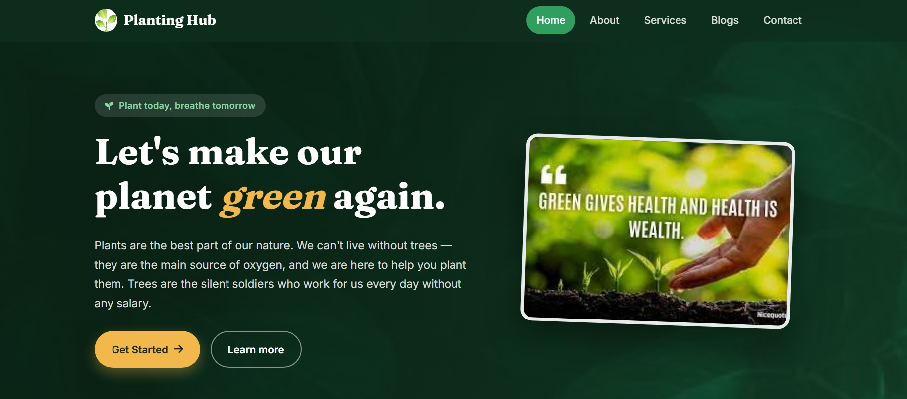

# 🌱 Planting Hub

A responsive landing page for **Planting Hub**, a fictional tree-planting community. I built it while learning web development and later redesigned it with a cleaner UI and some JavaScript interactions.

🔗 **Live demo:** https://lavanya-p-dev.github.io/Planting-Hub/



## Features

- Fully responsive layout (desktop, tablet and mobile)
- Sticky navbar with mobile menu and active-section highlighting
- Hero, About, Services, Blogs and Contact sections
- Scroll-reveal animations and animated counters
- Back-to-top button
- Respects `prefers-reduced-motion` for accessibility

## Tech Stack

- HTML5
- CSS3 (Flexbox, Grid, custom properties)
- Vanilla JavaScript (IntersectionObserver)
- Font Awesome and Google Fonts

## Project Structure

```
planting-hub/
├── index.html
├── css/style.css
├── js/main.js
└── assets/
```

## What I Learned

- Building responsive layouts with CSS Grid and Flexbox
- Organising a project into separate HTML, CSS and JS files
- Using the Intersection Observer API for scroll effects

## Author

**Pureddy Lavanya** 

> This is a practice project. Planting Hub is not a real organisation.